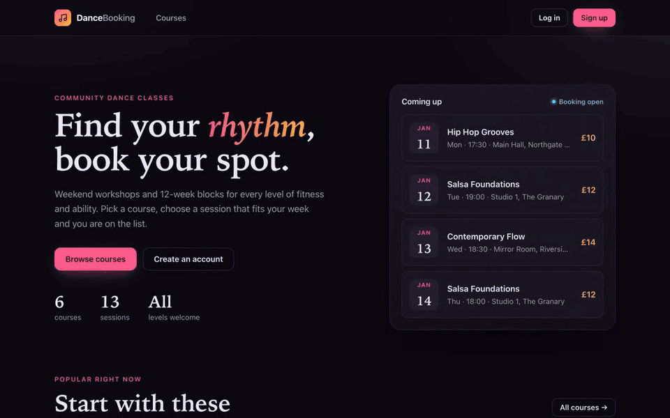
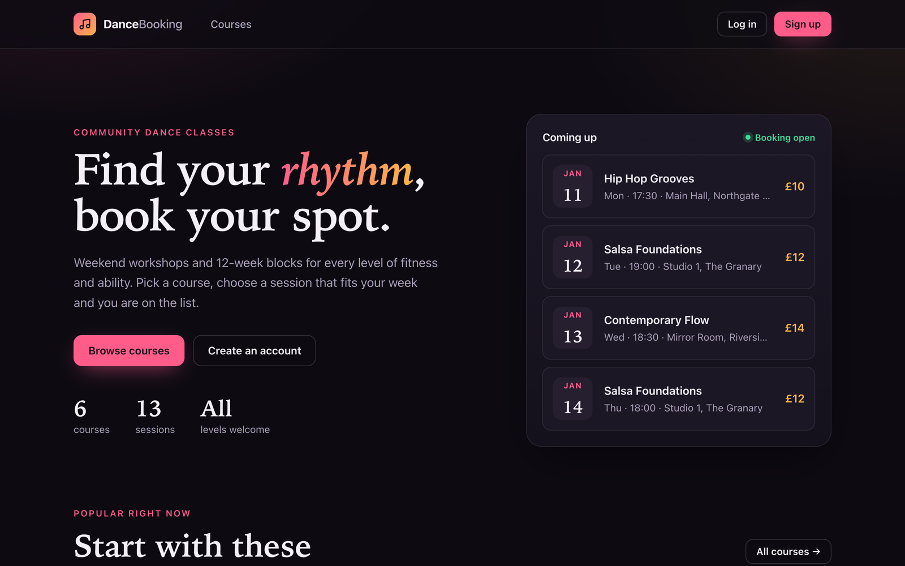
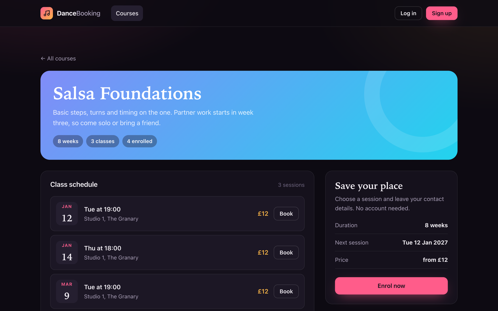
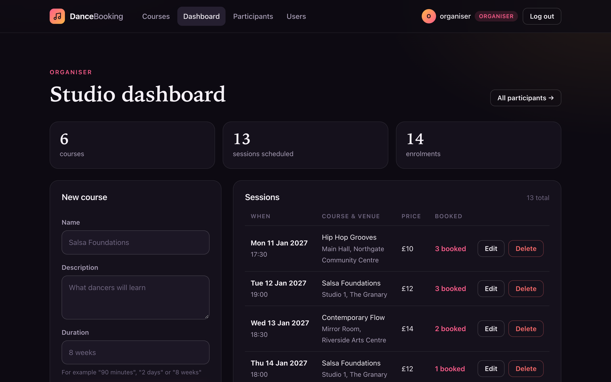
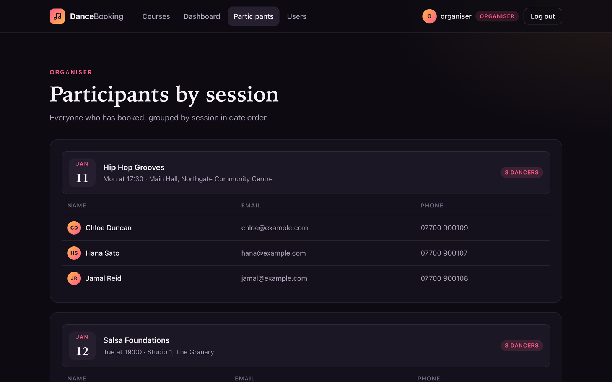
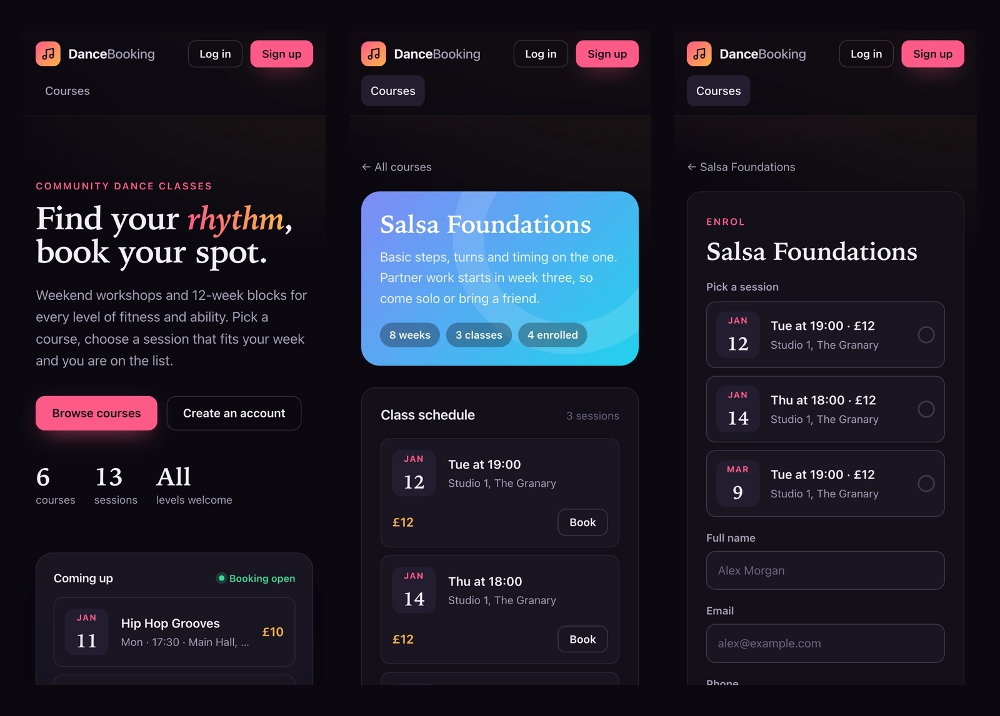
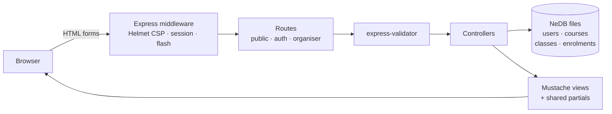

<div align="center">



# Dance Booking System

**Class booking for a community dance studio: browse courses, pick a session and enrol in a minute, while organisers run the timetable, the bookings and the accounts.**

[](https://dance-booking-system.onrender.com/)
[](https://github.com/Bogdusik/Dance-Booking-System/actions/workflows/ci.yml)


[Live demo](https://dance-booking-system.onrender.com/) · [Features](#features) · [Architecture](#architecture) · [Run it locally](#run-it-locally)

</div>

> **Try the organiser side:** log in as `organiser` / `dance-demo`. The demo runs on Render's free tier, so the first request can take about 30 seconds while it wakes up, and the data resets on every deploy. All courses, venues and people in it are made up.

## Features

<table>
  <tr>
    <td width="50%"></td>
    <td width="50%"></td>
  </tr>
  <tr>
    <td><b>Browse.</b> Every course shows its length, how many sessions it has, the next date and the lowest price.</td>
    <td><b>Book.</b> Each session has its own Book button that opens the form with that session already selected. No account needed.</td>
  </tr>
  <tr>
    <td></td>
    <td></td>
  </tr>
  <tr>
    <td><b>Run the studio.</b> Organisers add courses and sessions, edit or cancel them, and see how many people booked each one.</td>
    <td><b>Know who's coming.</b> Contact details for every booking, grouped by session. Visitors only see names.</td>
  </tr>
</table>



**Mobile-first layout:** the same pages on a 390 px phone screen.

### Roles

| | Visitor or member | Organiser |
|---|:---:|:---:|
| Browse courses and sessions | ✓ | ✓ |
| Enrol in a session | ✓ | ✓ |
| See participants' names | ✓ | ✓ |
| See participants' emails and phone numbers | | ✓ |
| Add, edit and delete courses and sessions | | ✓ |
| Manage accounts | | ✓ |

## Architecture



- **Server-rendered:** Express renders Mustache templates that share head, navigation and footer partials. The only client script is a small CSP-safe file for delete confirmations and fading messages.
- **Access control:** `isAuthenticated` and `isOrganiser` middleware protect the organiser routes. Passwords are hashed with bcrypt, and sessions use `httpOnly` cookies that are `secure` in production.
- **Validation:** every form goes through `express-validator` before it reaches a controller. Errors come back as flash messages on the same page.
- **Storage:** NeDB keeps each collection in a file under `db/`, so there is no database server to run. Deleting a course also removes its sessions and their enrolments.

## Tech stack

| Layer | Tools |
|---|---|
| Server | Node.js, Express 4, express-session, connect-flash, compression |
| Views | Mustache (mustache-express), hand-written CSS with no framework |
| Data | NeDB (`@seald-io/nedb`), file-based |
| Security | Helmet with a strict Content Security Policy, bcryptjs, express-validator |
| Logging | Winston |
| Tests | Mocha, Chai, Supertest |
| Delivery | Docker, Docker Compose, GitHub Actions (Node 20 and 22), Render |

## Run it locally

```bash
git clone https://github.com/Bogdusik/Dance-Booking-System.git
cd Dance-Booking-System
npm install
cp .env.example .env
npm start                 # http://localhost:3000
```

The repository ships with demo data. To rebuild it from scratch, run `npm run seed`. Then log in as `organiser` / `dance-demo`, or as one of the members `maya` and `leo` with the same password.

With Docker:

```bash
docker compose up -d      # http://localhost:3000
```

### Tests

```bash
npm test
```

36 integration tests cover authentication, access control, course and session management, enrolment and error pages. They use separate `test-*.db` files, so your demo data is left alone.

## Project structure

```
Dance-Booking-System/
├── app.js                 # Express setup: Helmet CSP, sessions, flash, nav state, routes
├── routes/                # index (public + enrolment), auth, organiser
├── controllers/           # course, organiser and auth logic
├── models/                # NeDB datastores
├── middlewares/           # auth guards, central error handler, async wrapper
├── utils/                 # validators, date and price formatting, logger
├── views/                 # Mustache pages
│   └── partials/          # head, nav, footer, course card
├── public/                # style.css, app.js, favicon
├── scripts/seed.js        # rebuilds db/ with fictional demo data
├── db/                    # NeDB data files
└── tests/                 # Mocha + Supertest suites
```

## What I learned

- **Server-side rendering without a framework:** shared layouts with Mustache partials, and view models prepared in the controllers so the templates stay logic-free.
- **Role-based access:** route-level guards and showing different data to visitors and organisers from the same page.
- **Content Security Policy in practice:** a strict `script-src 'self'` silently blocked inline `onsubmit` confirmations until the logic moved into a static script.
- **Validation and testing:** express-validator chains shared between the create and edit routes, with regression tests for the bugs they caught.
- **Containers and CI:** a Docker image for deployment and a GitHub Actions matrix across Node versions.
